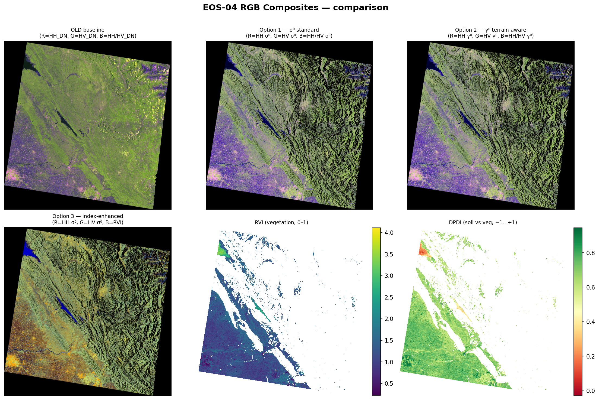
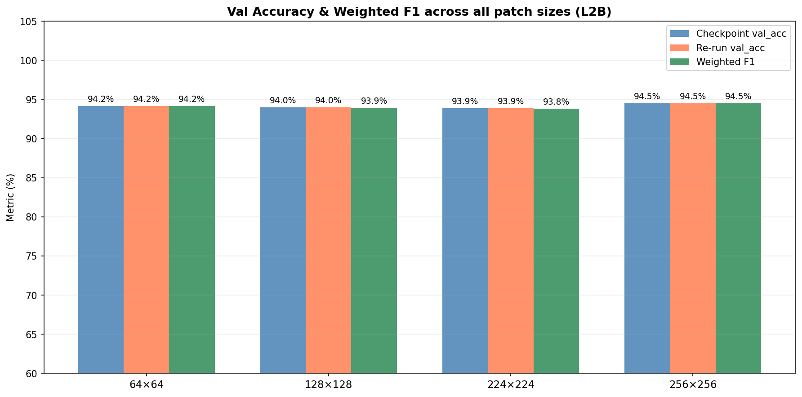
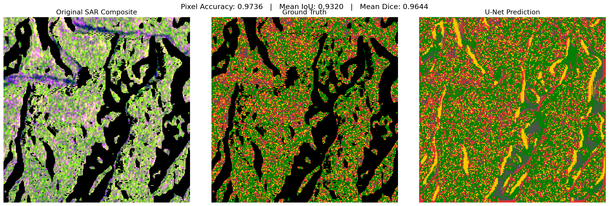

# EOS-04 SAR Land-Cover Classification (ISRO Level-2B ARD)

End-to-end pipeline that turns raw **ISRO EOS-04 C-band SAR** data (HH + HV, MRS mode, 18 m)
into a **georeferenced land-cover map**:

1. ISRO-documented radiometric calibration.
2. Physics-based labelling.
3. A multi-input **EfficientNet-B0 + MLP** patch classifier.
4. Full-scene inference to GeoTIFF.
5. A **U-Net** pixel-level segmentation model.

Classes: **Dense forest · Mixed vegetation · Urban**. Study scene: EOS-04 MRS acquisition of
**03 June 2026 over Himachal Pradesh, India**, obtained from ISRO's Bhoonidhi portal.

Developed during a remote research internship on an ISRO EOS-04 SAR research project
(May 2026 – present).

| Calibrated RGB composites (Step 2) | Full-scene land-cover map (Step 6) |
|---|---|
|  |  <br> 🟩 Dense forest · 🟨 Mix · 🟥 Urban |

## Highlights

* **Calibration follows the ISRO document.** Every equation comes from *EOS-04 Data Products Formats
  v1.2.5* (SAC/ISRO), eqs. 1–15:
  * noise-bias removal;
  * β⁰ / σ⁰ / γ⁰ with the per-pixel local incidence angle;
  * layover/shadow mask;
  * undoing the Level-2B terrain normalisation.

  See the [formulas](docs/EOS04_CALIBRATION_FORMULAS.md).
* **Multi-input deep model.** EfficientNet-B0 image features (ImageNet transfer learning) are
  fused with calibrated SAR statistics (and optionally 5 DEM terrain features) in an MLP branch.
* **Systematic study of four patch sizes:** 64, 128, 224 and 256 px (1.2–4.6 km on the ground).
  Validation accuracy is **93.9–94.5 %** for every size.
* **QGIS-in-the-loop labelling.** Every patch is exported as a polygon with its SAR and DEM
  statistics, labelled in QGIS, and predicted back to GeoTIFF maps that open directly in QGIS.
* **Honest evaluation:**
  * Kruskal–Wallis label checks;
  * a controlled SAR-only vs SAR+DEM ablation with McNemar's test;
  * a clear list of what is and isn't proven ([docs/RESULTS.md](docs/RESULTS.md)).

## Pipeline (task-wise folders)

```
 raw EOS-04 L2B (DN, HH+HV, LIA, mask, area)
   │  01_calibration              DN → β⁰ / σ⁰ / γ⁰ (ISRO eqs. 1-15), layover/shadow mask
   ▼
 calibrated GeoTIFFs
   │  02_composites_and_patches   RGB composites (OPT1 σ⁰ used) → 64/128/224/256 px patches + QGIS .shp
   │  03_dem_terrain              Copernicus DSM tiles → elevation / slope stats per patch
   ▼
 labelled patches (QGIS, HH/HV-ratio rule)
   │  04_label_validation         Kruskal-Wallis separability, visual montages
   │  05_classification_training  EfficientNet-B0 + SAR-feature MLP (± DEM)
   │  06_scene_prediction         whole scene → class map + confidence GeoTIFF
   │  07_model_evaluation         patch-size comparison, DEM ablation + McNemar
   │  08_segmentation_unet        pixel pseudo-masks → U-Net → evaluation
   ▼
 land-cover GeoTIFFs for QGIS
```

Each script starts with a **PROJECT CONTEXT** comment block: why the step exists, what it
produced and how to run it. Details per step are in [docs/PIPELINE.md](docs/PIPELINE.md).

## Results

**Patch classifier**, OPT1 σ⁰ composite, stratified 80/20 split (seed 42), 100 epochs.

| Patch size | Ground area | Labelled patches | Val patches | Val accuracy | Weighted F1 | Macro F1 |
|---|---|---:|---:|---:|---:|---:|
| 64 × 64 | 1.15 km | 11,663 | 2,333 | 94.17 % | 0.942 | 0.942 |
| 128 × 128 | 2.30 km | 3,910 | 782 | 93.99 % | 0.939 | 0.927 |
| 224 × 224 | 4.03 km | 1,307 | 262 | 93.89 % | 0.938 | 0.939 |
| **256 × 256** | 4.61 km | 999 | 200 | **94.50 %** | **0.945** | **0.950** |



**Does terrain (DEM) help?** In a controlled ablation (same 1,000 patches, same split, same
architecture), only the MLP input changes:

| Model | Features | Val accuracy |
|---|---|---:|
| A: SAR only | mean HH, mean HV, HH/HV ratio, RVI | 94.0 % |
| B: SAR + DEM | + elevation, slope mean / std / max / p15 | 92.0 % |

McNemar's test: χ² = 1.5, p = 0.22. On this scene the **DEM features gave no significant gain**.

**U-Net segmentation** on 808 pixel-level pseudo-mask patches: validation mean IoU ≈ 0.94
(the ground truth here is the HH/HV threshold rule, see below).



**Label validation** (999 patches): the classes differ strongly in the SAR features.
Kruskal–Wallis H = 842.7 for the HH/HV ratio (η² = 0.84) and H = 509.1 for HV (η² = 0.51),
both with p < 10⁻¹⁰⁰.

> **Read with care.** The labels come from HH/HV-ratio thresholds, not from an independent
> land-cover map, and the HH/HV ratio is also a model input. The accuracies therefore measure
> agreement with a physics-based labelling rule. All numbers come from a single scene and a
> single validation split. [docs/RESULTS.md](docs/RESULTS.md) lists the evidence and the open points.

## Quick start (Windows)

```powershell
git clone https://github.com/shivamd2502/EOS04-SAR-Land-Cover-Classification.git
cd EOS04-SAR-Land-Cover-Classification
python -m venv sar_env
.\sar_env\Scripts\Activate.ps1
pip install -r requirements.txt   # for a GPU, install torch/torchvision first from pytorch.org (CUDA 12.1 was used)

# math self-test of the calibration equations (no data needed)
python scripts\01_calibration\eos04_radiometric_preprocessing.py --self-test
```

The scripts use the project root `BASE_DIR = r"D:\ISRO_14"` and read and write their data in
`BASE_DIR\data\00_input … 08_segmentation_unet`, numbered like `scripts/` and `results/`.
Clone to that path, or edit `BASE_DIR` at the top of each script. Run them from the project
root in folder order (01 → 08). The data layout and where to get the EOS-04 products are
described in [docs/DATA.md](docs/DATA.md).

Tested environment: Windows 11, Python 3.12.1, PyTorch 2.5.1 + CUDA 12.1, NVIDIA RTX 3050 Laptop GPU.

## Repository layout

```
scripts/        the pipeline, one folder per task (01_calibration … 08_segmentation_unet)
results/        saved outputs of each task, same numbering: reports, metrics, figures, maps
docs/           PIPELINE, RESULTS, DATA, calibration formulas, ISRO EOS-04 format document
archive/        first version (June 2026): DN-based preprocessing, 300-patch classifier, ResNet34 U-Net
requirements.txt
```

## Tech stack

Python · PyTorch · torchvision (EfficientNet-B0) · rasterio · GDAL · geopandas · shapely ·
pyproj · NumPy · pandas · SciPy · scikit-learn · matplotlib · seaborn · QGIS · Label Studio
